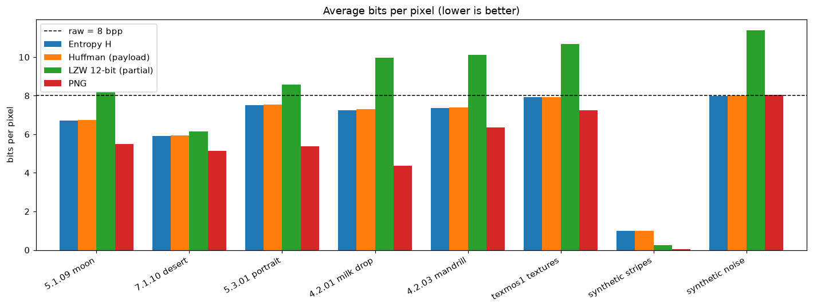

# Huffman and LZW Coding

Lossless image compression with **Huffman coding** (Huffman, 1952) and **LZW coding** (Welch, 1984): our own implementations, measured against the image entropy and against PNG.

This is the group project of **Group 8** for **INF605 Digital Image Processing** at the Turkish-German University (Fall 2026). Our assignment is paper 8 of the course project list: an encoder and decoder for both methods with bit packing, the compression ratio against the image entropy, and a comparison with PNG.

## Status

**Preliminary work (Week 10 progress check).** Our test images load, and the first steps of both methods run.

| Done | Still to do |
| --- | --- |
| Test images load as 8-bit grayscale | Bit packing and real file sizes (including the code table) |
| Histogram, probabilities and entropy | Huffman decoder and round-trip test |
| Huffman code construction (reproduces the paper's 3.42 example) | LZW decoder, table-full policy, variable code width |
| Partial LZW encoder (fixed 12-bit codes) | Experiments on the main parameters |
| PNG baseline with `cv2.imencode` | Final comparison, report and live demo |

## Repository structure

```text
.
├── notebooks/
│   └── week10_first_steps.ipynb   # Week 10 notebook: load images, entropy, Huffman, partial LZW
├── images/                        # Test images (USC-SIPI)
├── figures/                       # Figures and results table produced by the notebook
├── docs/
│   ├── Preliminary_Report.md      # Group briefing: the story behind both papers, in plain words
│   └── Week 10 Progress Report Huffman and LZW Coding.docx
├── Research_Papers/               # Huffman (1952) and Welch (1984) papers
├── Teachers_Materials/            # Project brief and group sign-up sheet
├── requirements.txt
└── LICENSE
```

## Getting started

Requires Python 3 (the notebook was run with Python 3.10).

```bash
git clone https://github.com/emrullah-enis-ctnky/Huffman-and-LZW-Coding.git
cd Huffman-and-LZW-Coding
pip install -r requirements.txt
jupyter notebook notebooks/week10_first_steps.ipynb
```

The notebook runs from top to bottom. It also works in VS Code. On Google Colab or Kaggle, clone the repository in a first cell, then install and open the notebook from there:

```python
!git clone https://github.com/emrullah-enis-ctnky/Huffman-and-LZW-Coding.git
%cd Huffman-and-LZW-Coding/notebooks
!pip install -r ../requirements.txt
```

## What the notebook shows

For eight images (six real ones and two synthetic ones) it prints the entropy, the average Huffman code length, a partial LZW result and the PNG size, all in bits per pixel:



## Library rule

We write the methods ourselves. NumPy, Matplotlib, pandas and OpenCV are used for reading images, colour conversion, tables and plots. `cv2.imencode` (PNG) is used **only** to compare results. No library function that implements Huffman or LZW coding is used.

## References

- D. A. Huffman, "A method for the construction of minimum-redundancy codes," *Proc. IRE*, vol. 40, no. 9, pp. 1098-1101, 1952. [doi:10.1109/JRPROC.1952.273898](https://doi.org/10.1109/JRPROC.1952.273898)
- T. A. Welch, "A technique for high-performance data compression," *Computer*, vol. 17, no. 6, pp. 8-19, 1984. [doi:10.1109/MC.1984.1659158](https://doi.org/10.1109/MC.1984.1659158)
- Test images: [USC-SIPI Image Database](https://sipi.usc.edu/database/), used for research purposes. USC-SIPI does not own the copyright of most of its images.

## AI tools

AI tools are used in this project. The full disclosure (which tool, for which part, and the prompts) will be in the final report, as the course requires.

## Team

- [@EmreAkdeniz42](https://github.com/EmreAkdeniz42)
- [@emrullah-enis-ctnky](https://github.com/emrullah-enis-ctnky)
- [@Yunus-Emre-Arik](https://github.com/Yunus-Emre-Arik)
- [@meeminoglu](https://github.com/meeminoglu)
- [@HamzaPecenek](https://github.com/HamzaPecenek)

## License

This project is licensed under the [MIT License](LICENSE).
